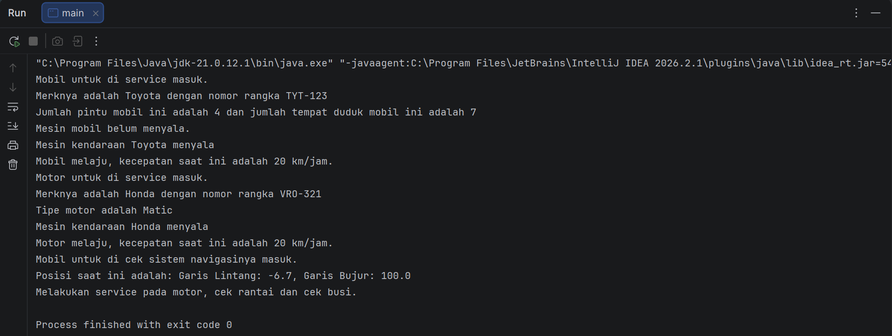
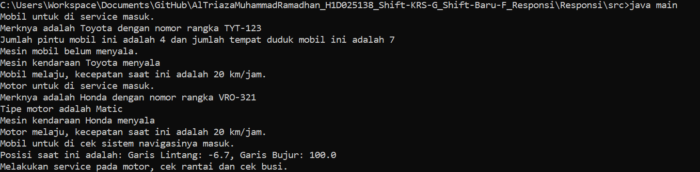

# AlTriazaMuhammadRamadhan_H1D025138_Shift-KRS-G_Shift-Baru-F_Responsi
Repositori untuk File-File Responsi Praktikum Pemrograman Berorientasi Objek tahun ajaran 2026/2027 Semester 3

- Nama: Al Triaza Muhammad Ramadhan
- NIM: H1D025138
- Shift KRS: G
- Shift Baru: F
- Tema Proyek: Otomotif (Digit Terakhir NIM: 8)

# Cara Compile dan Run Proyek Responsi di Terminal
1. Download Proyek dan Buka/Ekstrak, Jika Sudah Lalu Buka Folder AlTriazaMuhammadRamadhan_H1D025138_Shift-KRS-G_Shift-Baru-F_Responsi, Kemudian Folder Responsi, Kemudian Klik Kanan Folder src dan Klik Kiri pada "Copy as Path" atau "Copy Path"
2. Pastikan ada Java Development Kit terinstal
3. Buka Terminal Command Prompt sebagai Administrator
4. Di Terminal, Ketik cd Lalu Paste Path yang Sudah Di-Copy Tadi dan Tekan Enter
5. Jika Tidak Ada File Berformat .class Sama Sekali Maka ke Terminal Untuk Mengetik javac *.java Lalu Tekan Enter
6. Jika Sudah Ada File Berformat .class Maka ke Terminal Untuk Menjalankan java main Lalu Tekan Enter

# Hasil Output/Luaran Program
1. Menggunakan IntelliJ IDEA

2. Menggunakan Terminal Command Prompt

